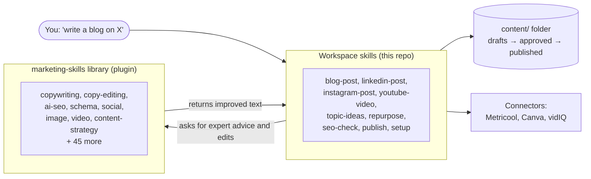
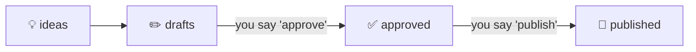

# AI Digital Marketing Workspace

A Claude Code workspace that plans, writes, checks and schedules content for one brand across
a **blog, LinkedIn, Instagram and YouTube**. You give it plain-English instructions such as
"write a blog on pricing mistakes". It drafts the content in your brand voice, scores blog
posts for SEO, and queues everything for your approval before anything goes live.

There is no app to install and no code to maintain. The workspace is made of three things:

- **Skills**: written instructions in `.claude/skills/` that tell Claude how to do each job
- **Connectors**: sign-ins to tools like Metricool, Canva and vidIQ, used to publish and research
- **Markdown files**: every idea, draft and published post is a plain text file under `content/`

It is built for small teams and solo marketers who want consistent output without hiring a
content team or learning a new app.

---

## How it works

The workspace has three kinds of skills that work together.



1. **Workspace skills** (this repo) run the process. They know your folders, your brand
   profile, the SEO score, and the approval rules. They write and move every file.
2. **The marketing-skills library** ([coreyhaines31/marketingskills](https://github.com/coreyhaines31/marketingskills),
   MIT licence, 53 skills) brings the marketing know-how: copywriting rules, AI-search
   optimisation, social hooks, video scripting, structured data and more. Workspace skills call
   it at fixed points and then apply its advice themselves.

3. **Copied open-source skills** (29, in this repo) fill the gaps: YouTube, X, Threads, Instagram
   and TikTok writing, newsletters, podcasts, community, SEO briefs, brand design, proposals,
   contract review, SOPs, support replies, reports and local video editing. Each one was read
   line by line before copying, and keeps its licence and a credit to its author. See
   [THIRD_PARTY_NOTICES.md](THIRD_PARTY_NOTICES.md).

If the library is not installed, every workspace skill still works. It skips the library steps
and tells you so.

Full details: **[docs/skill-library.md](docs/skill-library.md)**.

---

## What you can ask for

| Say this | What happens | Where the result goes |
|---|---|---|
| `setup` | Checks the library plugin, brand profile and connectors, and tells you how to fix each gap | chat checklist |
| `topic ideas for <theme>` | Researches the web and suggests 5–10 blog topics that don't repeat earlier content | `content/ideas/` |
| `write a blog on <topic>` | Researches, writes a 1,200–2,000 word post, scores it for SEO and fixes it once | `content/drafts/blog/` + `reports/seo/` |
| `seo check <file>` | Scores a blog post out of 100 and lists fixes | `reports/seo/` |
| `linkedin post about <topic>` | Writes a 150–300 word post with a strong first line | `content/drafts/linkedin/` |
| `instagram post about <topic>` | Writes a caption, hashtags and image brief, and makes the image in Canva if connected | `content/drafts/instagram/` |
| `youtube video about <topic>` | Writes 3 title options, a description, tags, a 5–8 minute script and a thumbnail brief | `content/drafts/youtube/` |
| `repurpose <approved blog>` | Turns one approved blog into a LinkedIn, Instagram and YouTube draft | the three social draft folders |
| `approve <file>` / `approve <file> for <date time>` | Moves a draft to the approved queue, optionally with a posting time | `content/approved/` |
| `publish <file>` / `publish all approved` | Schedules approved posts through Metricool | `content/published/` |
| `weekly review` | Summarises the queue: what's drafted, approved, published, and what needs attention | `reports/weekly/` |

You can also call any library skill directly, for example `/marketing-skills:copywriting` for
a landing page or `/marketing-skills:emails` for a welcome sequence.

**Copied skills you can ask for directly** (full list in [docs/skill-library.md](docs/skill-library.md#8-copied-open-source-skills-29)):

| Area | Skills |
|---|---|
| YouTube | `yt-hook-scripter`, `yt-title-optimizer`, `yt-description-writer` |
| X, Threads, TikTok | `x-post-writer`, `x-thread-builder`, `threads-post-writer`, `tt-hook-scripter`, `tt-trend-mapper` |
| Instagram | `ig-caption-writer`, `ig-carousel-planner`, `ig-hashtag-strategist` |
| Audience | `community-management`, `newsletter-writer`, `podcast-and-audiograms`, `voice-builder` |
| SEO planning | `seo-content-brief`, `seo-cluster` |
| Brand and design | `brand-guidelines`, `theme-factory`, `canvas-design`, `brand-review` |
| Business | `proposal-builder`, `contract-review`, `performance-report`, `status-report`, `process-doc`, `draft-response`, `kb-article` |
| Video | `ffmpeg-skill` (needs FFmpeg on your computer) |

---

## The content pipeline



Every item is a Markdown file that moves through four folders. Two steps need you:

- **Approve.** Nothing enters `approved/` unless you say "approve". Blog posts must also reach
  the SEO threshold (70 out of 100 by default) unless you say "approve anyway".
- **Publish.** Nothing goes out unless you say "publish". Scheduled routines can draft, but they
  never approve or publish.

Every change is a git commit, so you have a full history and can undo anything.

---

## Quick start (about 15 minutes)

**You need:** [Claude Code](https://claude.com/claude-code) (the desktop app or CLI) and git.

1. **Get the workspace.** Clone this repository and open the folder in Claude Code.
2. **Install the marketing skills library.** Run these two commands in a terminal. Claude
   can't install plugins for you.

   ```bash
   claude plugin marketplace add coreyhaines31/marketingskills
   ```

   ```bash
   claude plugin install marketing-skills@marketingskills
   ```

   If a command fails with a GitHub `401` error, put `env -u GITHUB_TOKEN ` in front of it.
3. **Describe your brand.** Edit `brand/profile.md` and `brand/keywords.md`, and replace every
   `Example:` value with your own: name, audience, tone, content pillars, banned words, calls to
   action, keyword clusters. Add a few of your own past posts to `brand/examples/` so drafts
   match your voice.
4. **Connect your tools.** Run `/mcp` in Claude Code and sign in to the ones you use:

   | Connector | Needed for | Without it |
   |---|---|---|
   | Metricool | publishing to LinkedIn, Instagram, YouTube | drafts still work; publishing stops |
   | Canva | making Instagram images | you get an image brief instead |
   | vidIQ | YouTube keyword research | Claude picks keywords itself |

5. **Check everything.** Start a new session and say `setup`. Fix anything marked `ACTION`.
6. **Try it.** Say `topic ideas`, then `write <one of the idea files>`.

---

## Safety rules built in

- Nothing is approved or published without your explicit words in chat.
- A failed publish is never retried automatically, so a post can't go out twice.
- Banned words from your brand profile are never used.
- No passwords or API keys are stored in the repo; connectors sign in through `/mcp`.
- Library skills only suggest text. They never create, move or rename your content files.

The full rule list is in [CLAUDE.md](CLAUDE.md).

---

## Folder layout

```
ai-digital-marketing/
├── .claude/
│   ├── skills/               workspace skills + 29 copied open-source skills
│   └── product-marketing.md  points library skills at brand/profile.md
├── .mcp.json                 connector list (no secrets)
├── brand/
│   ├── profile.md            voice, audience, pillars, CTAs, banned words, SEO threshold
│   ├── keywords.md           keyword clusters
│   └── examples/             your past posts, used as style samples
├── content/
│   ├── ideas/
│   ├── drafts/<channel>/
│   ├── approved/<channel>/
│   └── published/<channel>/
├── reports/
│   ├── seo/                  one SEO report per blog draft
│   ├── seo/clusters/         keyword cluster plans (seo-cluster)
│   └── weekly/               weekly review reports
├── docs/                     guides (see below)
├── THIRD_PARTY_NOTICES.md    credits and licences for the copied skills
└── CLAUDE.md                 rules Claude follows in this folder
```

---

## Documentation

| Document | What it covers |
|---|---|
| [docs/skill-library.md](docs/skill-library.md) | Every workspace skill, how it uses the library, the SEO scoring, the 53-skill library catalogue, and the 29 copied skills |
| [THIRD_PARTY_NOTICES.md](THIRD_PARTY_NOTICES.md) | Source, commit, licence and author of every copied skill |
| [docs/research/](docs/research/) | The research report on Claude skill libraries behind the choices |
| [docs/connectors.md](docs/connectors.md) | Connectors, optional blog hosts, and the library install options |
| [docs/routines.md](docs/routines.md) | Optional scheduled runs (Monday topic ideas, Friday weekly review) |
| [docs/examples/](docs/examples/) | Sample outputs for a made-up brand, "Northwind Analytics" |
| [CLAUDE.md](CLAUDE.md) | The rules, approval procedure and content file format |

---

## Credits

The marketing-skills library is by [Corey Haines](https://github.com/coreyhaines31) and is
released under the MIT licence at
[github.com/coreyhaines31/marketingskills](https://github.com/coreyhaines31/marketingskills).
This workspace calls it as an installed plugin and does not copy its files.

The 29 copied skills come from Anthropic (Apache-2.0), Sergey Bulaev, Frank Heijdenrijk
(social-media-skills), AgriciDaniel and contributors (claude-seo) and kajisho5 (ffmpeg-skill), all
MIT. Each keeps its licence in its folder; see [THIRD_PARTY_NOTICES.md](THIRD_PARTY_NOTICES.md).
