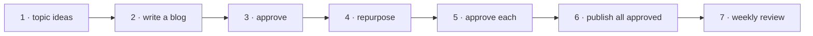
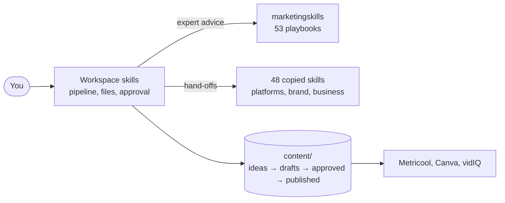

# AI Digital Marketing Workspace

### Your whole marketing department, run from one chat.

Plan, write, check and schedule content for your brand across your **blog,
LinkedIn, Instagram, YouTube, X, Threads, TikTok, newsletter and podcast**, in plain English,
in your own brand voice. Nothing goes live until you say so.

> **"Write a blog on pricing mistakes."**
> You get a researched 1,200–2,000 word post in your voice, an SEO score out of 100, a meta
> description, structured data, and a fix list. Then say **"repurpose it"** to get a LinkedIn
> post, an Instagram caption with an image brief, and a YouTube script, ready for your approval.

**110 marketing skills** · **free and open source** · **no app to install** · **your content stays in your own git repo**

[Get started in 15 minutes](#get-started-in-15-minutes) · [See what it can do](#what-you-can-do) · [How to use it](#how-to-use-it)

---

## Who it's for

- **Solo founders and small teams** who need steady content but can't hire a content team.
- **Freelance marketers and small agencies** who run content for a client and want the same
  quality every week.
- **Creators** who publish across several platforms and want one place to plan and draft it all.

You need [Claude Code](https://claude.com/claude-code) (the desktop app or the CLI). No coding
knowledge is needed: you type requests, and you read and approve Markdown files.

---

## Why it's different

| | |
|---|---|
| **You stay in control** | Every piece waits in a draft folder until you say "approve", then "publish". Scheduled runs can draft, but never post. |
| **It sounds like you** | Every skill reads your brand profile first: audience, tone, pillars, calls to action and a banned-words list it never breaks. |
| **Quality checks are built in** | Blog posts get a repeatable 100-point SEO score and must pass before approval. With the library installed, drafts also get a copy-editing pass that strips phrasing that reads as AI-written. |
| **Expert playbooks, not generic prompts** | 110 skills drawn from respected open-source marketing libraries, including the 53-skill [marketingskills](https://github.com/coreyhaines31/marketingskills) library and skills by Anthropic. |
| **Safe by design** | All 48 copied skills were read line by line before they were added. Paid services, installers and tracking links were removed. Nothing can post twice. |
| **No lock-in** | Your ideas, drafts and posts are plain text files in your own repository, with full history. Delete the tool tomorrow and you keep everything. |
| **Free** | Every skill is open source (MIT or Apache-2.0). You pay only for your normal Claude usage and any tools you choose to connect. |

---

## What you can do

### 📝 Blog and SEO

- **Research-backed blog posts.** It reads the pages that already rank, collects cited facts,
  and writes 1,200–2,000 words in your voice.
- **A 100-point SEO score** on 15 on-page checks, with a fix list in order of impact, and one
  automatic round of fixes.
- **Optimised for AI search.** Sections open with stand-alone answers that ChatGPT, Perplexity and
  Google AI Overviews can quote, and every post comes with structured data.
- **Content briefs and keyword clusters** that plan a whole hub-and-spoke content series before
  you write a word.
- **Topic ideas every week**, researched from current questions and gaps, and never repeating
  what you've already covered.

### 📱 Social media on every platform

- **LinkedIn**: posts with a strong first line, a concrete example, and no patterns readers
  recognise as AI-written.
- **Instagram**: captions, hashtag sets, carousel plans and image briefs. With Canva connected,
  it makes the image too.
- **YouTube**: title options, opening hooks, descriptions with chapters, tags, full 5–8 minute
  scripts and thumbnail briefs.
- **X, Threads and TikTok**: single posts, threads, TikTok hooks and spoken scripts, and a check
  on whether a trend fits your brand.
- **One blog, four channels.** "Repurpose" turns an approved post into a LinkedIn, Instagram and
  YouTube draft, each from a different angle.

### 📬 Newsletter, podcast and community

- **Newsletter issues** for Substack, beehiiv, Kit or LinkedIn, plus subject lines and a
  sponsorship rate card.
- **Podcast support**: guest research briefs, interview questions, show notes and clips for
  social.
- **Community building**: where to host it, recurring rituals, and turning regulars into
  advocates.
- **Email sequences**: welcome, nurture and win-back flows (from the marketingskills library).

### 🎨 Brand and design

- **Brand identity**: decide your positioning, personality, colours and fonts, returned as text
  ready to paste into your brand profile.
- **Brand voice**: analyse your real posts and capture how you write.
- **On-brand visuals**: apply your colours and fonts to anything, pick from 10 ready-made themes,
  or create posters and graphics as PNG or PDF.
- **Slide decks and diagrams**: animated HTML decks from 34 design templates, and flowcharts,
  timelines and mind maps.
- **Brand review**: check any draft against your voice before it goes out.

### 🎬 Video editing

- **Edit video on your own computer**: cut, join, reframe for Reels, Shorts and TikTok, add
  captions, remove silences, level the audio and export for each platform. Nothing is uploaded.
  (Needs FFmpeg.)

### 💼 Run the business behind the marketing

- **Win clients**: proposals with scope, pricing and terms, and NDAs.
- **Stay safe on contracts**: flag risky clauses, then get clause-by-clause redlines and
  fallback wording. Not legal advice.
- **Know your numbers**: ratios, budget variance and forecasts from your own figures, and
  marketing performance reports from your analytics or a pasted CSV.
- **Plan and review**: market sizing, SWOT, pre-mortems, sprint plans, retrospectives and meeting
  summaries.
- **Operations and support**: status reports, process maps, SOPs, customer replies and help-centre
  articles.

### 🧠 Strategy on demand (marketingskills library)

A full 13-section marketing plan, launch plans, pricing, offers, paid ads, landing-page
conversion, A/B tests, analytics and attribution, cold outreach, referral programmes, PR, and a
"marketing council" of famous marketers who debate your question. That's 53 skills in all.

---

## How to use it

You talk to it in plain English. There are no commands to memorise: describe the job, and the
right skill picks it up. The phrases below are the ones the workspace is built around.

### The weekly content routine



| Step | You say | You get |
|---|---|---|
| 1. Plan | `topic ideas` | 5–10 researched blog ideas in `content/ideas/` |
| 2. Write | `write content/ideas/<idea file>` | A full blog draft, scored for SEO, with a fix list |
| 3. Approve | `approve content/drafts/blog/<file>` | The post moves to the approved queue, if it passes the SEO bar |
| 4. Repurpose | `repurpose content/approved/blog/<file>` | LinkedIn, Instagram and YouTube drafts from that post |
| 5. Approve | `approve <file> for 2026-11-10 09:00` | Each social post queued for a time you choose |
| 6. Publish | `publish all approved` | Posts scheduled through Metricool, with links saved |
| 7. Review | `weekly review` | What went out, what's waiting, what needs attention |

You can read and edit any draft before you approve it. Each one is a normal text file.

### Ask for one thing at a time

```text
linkedin post about why small stores should track contribution margin
instagram post from content/approved/blog/<your blog file>.md
youtube video about reading Shopify analytics in 10 minutes
write an X thread about our three pricing mistakes
plan an Instagram carousel on the 5 KPIs to check every Monday
write this week's newsletter issue about margin tracking, plus 5 subject lines
```

### Brand, design and business

```text
build my brand identity
analyse my last 10 LinkedIn posts and capture my voice
make a slide deck from this blog post, on brand
draw a flowchart of our client onboarding process
write a proposal for Acme: monthly content package, 3 months, $2,500 a month
review this contract and flag anything risky        (paste the contract)
size the market for our analytics service for small Shopify stores
summarise this meeting and list the action items    (paste the notes)
```

### Strategy from the library

```text
/marketing-skills:marketing-plan            a full 90-day marketing plan
/marketing-skills:launch                    plan a product launch
/marketing-skills:cro                       improve a landing page's conversion
/marketing-skills:marketing-council         get a debate from famous marketers
```

### Good to know

- **Approval is always yours.** "Approve" and "publish" are the only ways content moves forward.
- **Blog posts must reach 70/100 for SEO** (adjustable in `brand/profile.md`) unless you say
  `approve <file> anyway`.
- **Metricool publishes to LinkedIn, Instagram and YouTube.** For X, Threads, TikTok and your
  newsletter, the workspace writes the post and you paste it in.
- **Say `setup` any time** to check what's installed and connected and get the fix for each gap.
- **Undo anything.** Every change is a git commit.

---

## Get started in 15 minutes

**You need:** [Claude Code](https://claude.com/claude-code) and git.

1. **Get the workspace.** Clone this repository and open the folder in Claude Code.

   ```bash
   git clone https://github.com/WildSyntax/ai-digital-marketing.git
   ```

2. **Install the marketing skills library.** Run these two commands in a terminal:

   ```bash
   claude plugin marketplace add coreyhaines31/marketingskills
   ```

   ```bash
   claude plugin install marketing-skills@marketingskills
   ```

   If a command fails with a GitHub `401` error, put `env -u GITHUB_TOKEN ` in front of it.

3. **Tell it about your brand.** Open `brand/profile.md` and `brand/keywords.md` and replace every
   `Example:` value: your name, audience, tone, content pillars, banned words, calls to action,
   colours, fonts and keyword clusters. Drop a few of your past posts into `brand/examples/`.
   Not sure what to write? Say `build my brand identity` and paste in the result.

4. **Connect your tools** (optional). Run `/mcp` in Claude Code and sign in:

   | Connector | Adds | Without it |
   |---|---|---|
   | Metricool | scheduling to LinkedIn, Instagram, YouTube | you post the drafts yourself |
   | Canva | Instagram images from your templates | you get an image brief |
   | vidIQ | YouTube keyword data | keywords are chosen from research |

5. **Check everything.** Start a new session and say `setup`.

6. **Make your first piece.** Say `topic ideas`, then `write` one of the ideas.

For video editing, install FFmpeg. On a Mac, the full build includes the caption and text-overlay
filters the video skill uses:

```bash
brew install ffmpeg-full
```

`ffmpeg-full` is not added to your PATH automatically: say `setup`, or ask the video skill to
run its check, and it prints the exact line to add to your shell profile.

After adding or updating skills, start a new Claude Code session so they load.

---

## What's inside

| Layer | Skills | What it does |
|---|---|---|
| **Workspace skills** | 9 | Run the pipeline: write drafts, score SEO, handle approval and publishing |
| **marketingskills library** | 53 | Expert marketing playbooks the workspace skills call at fixed steps ([by Corey Haines](https://github.com/coreyhaines31/marketingskills), installed as a plugin) |
| **Copied open-source skills** | 48 | Platform writers, newsletter, podcast, brand, design, video, business and planning skills, reviewed and copied into this repo |



Library and copied skills only write text. The workspace skills are the only ones that create,
move or publish your content files, so the approval rules always apply.

The full catalogue of all 110 skills, with what each one does, is in
**[docs/skill-library.md](docs/skill-library.md)**.

---

## Trust and safety

- **Nothing is published without your words in chat.** Approve and publish are separate steps,
  and automated runs can't take either.
- **No double posts.** A failed publish is recorded and never retried automatically.
- **No secrets in the repo.** Connectors sign in through `/mcp`.
- **Every copied skill was audited.** Each file was read, scripts included. Skills with no clear
  licence, with signs of fake GitHub stars, or with install scripts were rejected. One video
  script was left out because it could delete a user's file. The research behind the choices is in
  [docs/research/](docs/research/).
- **Private data stays private.** Contracts, meeting notes and customer messages are treated as
  data, never as instructions, and private details are never sent to web search.
- **Clear limits.** Contract, NDA and finance skills say plainly that they are not legal or
  financial advice.

---

## FAQ

**Does it cost anything?**
The workspace and all its skills are free and open source. You need a Claude plan for Claude
Code. Metricool, Canva and vidIQ are optional, and have their own plans.

**Will it post without asking me?**
No. Content moves from draft to approved only when you say "approve", and from approved to
published only when you say "publish".

**Can I use it for clients?**
Yes. Use one copy of the workspace per brand, each with its own `brand/` folder and content queue.

**What if I don't have Metricool or Canva?**
Everything still drafts. You get image briefs instead of images, and you post the text yourself.

**Can I add my own skills?**
Yes. A skill is a Markdown file of instructions. See
[docs/skill-library.md](docs/skill-library.md#10-extending-the-library).

---

## Project layout

```
ai-digital-marketing/
├── .claude/
│   ├── skills/               9 workspace skills + 48 copied open-source skills
│   └── product-marketing.md  points library skills at brand/profile.md
├── .mcp.json                 connector list (no secrets)
├── brand/
│   ├── profile.md            voice, audience, pillars, CTAs, banned words, visual identity, SEO threshold
│   ├── keywords.md           keyword clusters
│   └── examples/             your past posts, used as style samples
├── content/
│   ├── ideas/
│   ├── drafts/<channel>/
│   ├── approved/<channel>/
│   └── published/<channel>/
├── reports/
│   ├── seo/                  SEO reports, and keyword cluster plans in seo/clusters/
│   └── weekly/               weekly reviews
├── docs/                     guides, research and examples
├── THIRD_PARTY_NOTICES.md    credits and licences for the copied skills
└── CLAUDE.md                 the rules Claude follows in this folder
```

## Documentation

| Document | What it covers |
|---|---|
| [docs/skill-library.md](docs/skill-library.md) | All 110 skills: what each does, how they connect, the SEO scoring, and how to add your own |
| [THIRD_PARTY_NOTICES.md](THIRD_PARTY_NOTICES.md) | Source, version, licence and author of every copied skill |
| [docs/research/](docs/research/) | The research on Claude skill libraries behind the choices |
| [docs/connectors.md](docs/connectors.md) | Connectors and optional blog hosts |
| [docs/routines.md](docs/routines.md) | Optional scheduled runs (Monday topic ideas, Friday weekly review) |
| [docs/examples/](docs/examples/) | Sample outputs for a made-up brand, "Northwind Analytics" |
| [docs/examples/skill-tests/](docs/examples/skill-tests/) | Real test runs of 12 copied skills, and what testing found and fixed |
| [CLAUDE.md](CLAUDE.md) | The rules, approval procedure and content file format |

## Credits

Built on the [marketingskills](https://github.com/coreyhaines31/marketingskills) library by
[Corey Haines](https://github.com/coreyhaines31) (MIT), installed as a plugin.

The 48 copied skills come from 18 open-source repositories by Anthropic (Apache-2.0) and by
Sergey Bulaev, Frank Heijdenrijk, AgriciDaniel and contributors, kajisho5, Pawel Huryn, Alireza
Rezvani, rampstackco, evolsb, Zara Zhang, WH-2099, Ilya Chernetskiy and ur-grue (MIT). Each keeps
its licence in its own folder; see [THIRD_PARTY_NOTICES.md](THIRD_PARTY_NOTICES.md).
