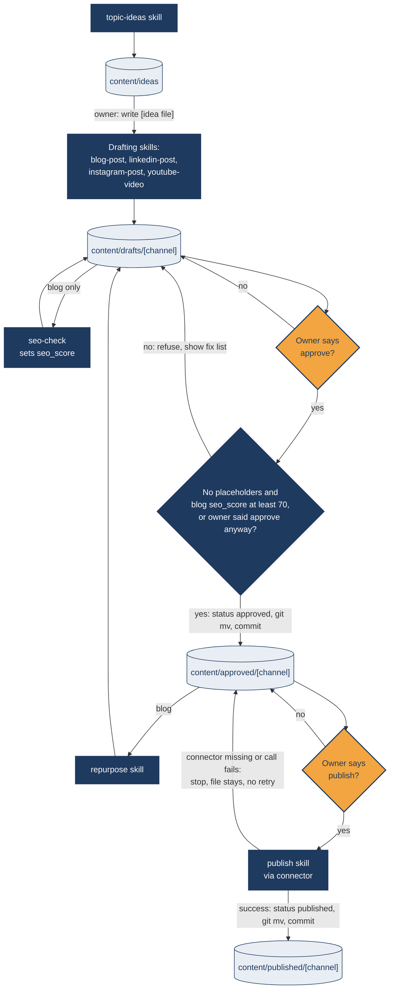

# mermaid test
Prompt: "Draw a flowchart of our content pipeline: ideas, drafts, approved, published, with the approve and publish steps that need the owner."
Date: 2026-11-05
Result: PASS WITH ISSUES

Test notes (not part of the output):
- `Skill` tool call `mermaid` failed with "Unknown skill: mermaid": the skill is not in this session's skill list (SKILL.md on disk was edited 00:46 on 2026-11-05). I followed `.claude/skills/mermaid/SKILL.md` from disk: picked Flowchart, read `references/flowchart.md` (node shapes, edge labels, classDef), generated the code, applied styling with the brand colours from `brand/profile.md` (#1F3A5F, #E8EEF4, #F2A541).
- Pipeline taken from CLAUDE.md (Pipeline, Rules 1-5, Approval procedure). The 70 in the approval check is `seo_threshold` from `brand/profile.md`.
- Syntax check: no Mermaid CLI is installed and nothing was installed. I rendered the code with the mermaid 11.17.2 bundle already on this machine (`~/.claude/plugins/marketplaces/claude-plugins-official/plugins/code-modernization/assets/vendor/mermaid.min.js`), served from the scratchpad on 127.0.0.1 and opened in the browser pane, with `securityLevel: 'strict'` (GitHub renders Mermaid in a sandbox with similar restrictions). Result: `mermaid.parse` and `mermaid.render` both succeeded. Negative control: `flowchart LR\n A --> B -->` threw "Parse error on line 4", so the check does catch errors. Not tested on github.com itself.
- GitHub-safe choices: classic node shapes only (no v11.3+ `@{ shape: ... }` syntax), all labels with spaces or punctuation quoted, no `<` or `>` inside labels (`[channel]` stands in for `<channel>`), ` ` for line breaks, no `%%{init}%%` directive, no click callbacks, hex colours in classDef (readable in GitHub light and dark themes).

---

## Content pipeline

Orange diamonds are the two steps that need the owner to say "approve" or "publish" in chat. Scheduled routines never pass these gates.

Key:
- Cylinders: content folders (the review queue). `status` in front matter always matches the folder.
- Navy boxes: skills and automatic checks.
- Orange diamonds: owner decisions.

---

## Issues found in the skill

1. **Skill not loadable in this session.** `Skill(mermaid)` returned "Unknown skill: mermaid" although `.claude/skills/mermaid/SKILL.md` exists. Same cause as brand-review: the session's skill list predates the skill. Fix: restart the session after adding vendored skills.
2. **No validation step.** SKILL.md "Output Specification" item 2 says the code should have "correct syntax that renders directly", but the workflow (lines 21-26) has no way to check it, and no validator ships with the skill. Fix: add a step "If `mmdc` (Mermaid CLI) is installed, run `mmdc -i <file> -o /tmp/out.svg`; otherwise say the syntax was not machine-checked." Do not bundle a validator without vetting.
3. **No GitHub-compatibility guidance.** The workspace renders diagrams on GitHub (README, `docs/skill-library.md` lines 37 and 301), but SKILL.md never says which features GitHub supports. `references/flowchart.md` promotes v11.3.0+ shapes (line 307 onward) and the references folder includes newer or niche types (`cynefin.md`, `eventmodeling.md`, `ishikawa.md`, `railroad.md`, `swimlanes.md`, `venn.md`, `wardley.md`, `treeView.md`) that may not render on GitHub's Mermaid version. Fix: add a short "For GitHub" note to SKILL.md: prefer classic shapes, quote labels, avoid `<`/`>` in labels, avoid `click` and `%%{init}%%` theme overrides, and avoid diagram types not listed in the table.
4. **Description and table out of date.** Front matter line 3 says "18 more diagram types"; the table lists 23 types and `references/` holds 30+ type files, nine of them not in the table (cynefin, eventmodeling, ishikawa, railroad, swimlanes, venn, wardley, treeView, config-tidy-tree). Fix: update the count to match the table, and either add the extra types to the table with a "may not render on GitHub" mark or remove their reference files.
5. **Stray template variable.** SKILL.md last line `User requirements: $ARGUMENTS` only works when invoked as a slash command; harmless but noisy when the skill is read directly. Fix: leave as is or replace with "Use the owner's request as the requirements."
6. **"Read brand/profile.md first" is under-specified.** The workspace header (line 16) says to read the profile but not what to use from it. Fix: "use the Visual identity colours in classDef when styling."

End to end: following the on-disk SKILL.md produced valid Mermaid that renders with mermaid 11.17.2 in strict mode and correctly shows both owner gates and the failure paths from CLAUDE.md.
