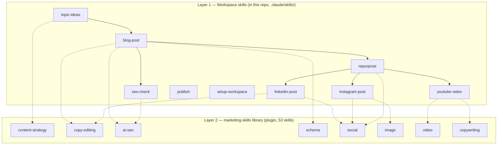
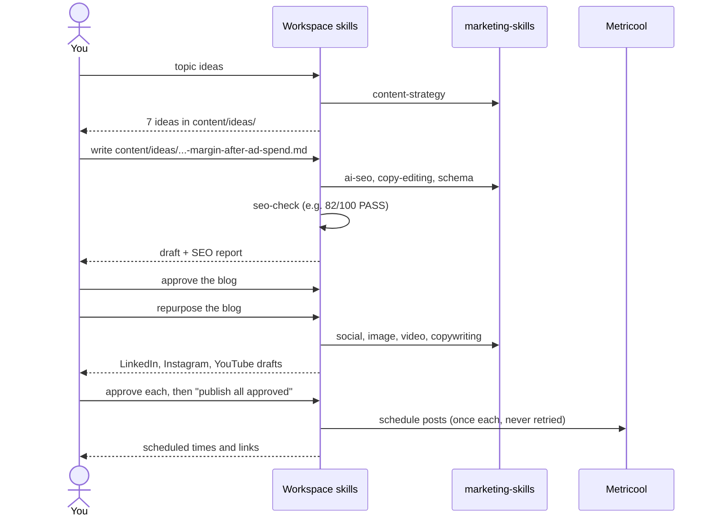

# The Skill Library

This guide explains every skill in the AI Digital Marketing Workspace: what each one does, how
to ask for it, what it produces, and how it works with the open-source **marketing-skills**
library. It is written for anyone using or evaluating the workspace, including marketers,
clients and teammates. You don't need any coding knowledge.

**Contents**

1. [What a skill is](#1-what-a-skill-is)
2. [Two layers: workspace skills and the library](#2-two-layers-workspace-skills-and-the-library)
3. [Installing and checking the library](#3-installing-and-checking-the-library)
4. [Workspace skills, one by one](#4-workspace-skills-one-by-one)
5. [How the SEO score works](#5-how-the-seo-score-works)
6. [A full example: one idea to four channels](#6-a-full-example-one-idea-to-four-channels)
7. [The full library catalogue (53 skills)](#7-the-full-library-catalogue-53-skills)
8. [Using library skills on their own](#9-using-library-skills-on-their-own)
9. [Extending the library](#10-extending-the-library)
10. [Troubleshooting and FAQ](#11-troubleshooting-and-faq)

---

## 1. What a skill is

A **skill** is a written playbook that Claude follows. It's a Markdown file (`SKILL.md`) that
says, step by step, how to do one job, for example "write a LinkedIn post". It covers what to
read first, which rules to follow, what format to produce, and where to save the result.

When you say "linkedin post about pricing", Claude recognises the request, opens the matching
skill and follows it. The same request always goes through the same steps and checks, so the
output stays consistent from one week to the next.

---

## 2. Two layers: workspace skills and the library

| | Workspace skills | marketing-skills library |
|---|---|---|
| **Where** | this repo, `.claude/skills/` | Claude Code plugin, installed once per computer |
| **Made by** | built for this workspace | [Corey Haines](https://github.com/coreyhaines31/marketingskills), MIT licence |
| **How many** | 9 | 53 |
| **Job** | run the process: files, folders, front matter, SEO score, approval, publishing | expert marketing know-how: copy rules, AI search, social, video, schema |
| **Writes files?** | yes, and commits each change | no, it returns text and advice only |
| **Named** | `blog-post`, `seo-check`, ... | `marketing-skills:copywriting`, `marketing-skills:ai-seo`, ... |

### How the two layers connect

Each workspace skill has a **`## Requires`** section near the top. It lists the library skills
and connectors that skill uses. Inside the steps, every place the library is used is marked
**Library**. For example, from `linkedin-post`:

> **Library:** use `marketing-skills:social` LinkedIn guidance for the hook and line rhythm,
> then run `marketing-skills:copy-editing` on the body. The rules above win over library advice.

Three rules apply to every library call:

1. **Workspace rules win.** If library advice conflicts with the skill's own format rules (word
   counts, required sections, banned words), the workspace rule applies.
2. **Library skills never touch your content files.** They return text. The workspace skill
   writes the file, keeps the front matter, and commits.
3. **Missing library means skip, not stop.** If the plugin isn't installed, the skill skips its
   **Library** steps, finishes the job, and adds "marketing-skills library not installed; say
   `setup` to fix" to its reply.

### Brand context for the library

Library skills look for a brand context file before they start. The workspace provides
`.claude/product-marketing.md`, a short pointer that tells every library skill to read
`brand/profile.md` and `brand/keywords.md`. Your brand details live in one place, and the
library and the workspace always use the same version.

---

## 3. Installing and checking the library

The workspace depends on two library pieces. Each person installs them once per computer.

| # | Piece | Command |
|---|---|---|
| 1 | The **marketplace**, which registers the GitHub repo as a plugin source | `claude plugin marketplace add coreyhaines31/marketingskills` |
| 2 | The **plugin**, which installs the 53 skills | `claude plugin install marketing-skills@marketingskills` |

Run them in a terminal, then start a new Claude Code session so the skills load. Claude doesn't
run these for you: installing software is left to the person who owns the computer.

**Check with `setup`.** Say `setup` (or "check setup") in the workspace. The `setup-workspace`
skill reports a checklist:

| Check | OK when | If not |
|---|---|---|
| Library plugin | `marketing-skills@marketingskills` is installed and its skills are loaded | prints the two install commands, or asks you to start a new session |
| Required library skills | all 9 skills the workspace calls are present | names the missing one; suggests `claude plugin update marketing-skills@marketingskills` |
| Brand context file | `.claude/product-marketing.md` exists | creates it and commits it |
| Brand profile | no `Example:` placeholders left | lists the lines still to fill in |
| Connectors | Metricool, Canva and vidIQ tools are available | says what stops working, and "connect via /mcp" |
| Git | working tree clean, remote set | lists uncommitted files |

**Updating the library:** `claude plugin update marketing-skills@marketingskills`, then a new
session, then `setup`.

---

## 4. Workspace skills, one by one

Each entry shows what to say, what you get, which library skills help, and which connectors are
used.

### setup-workspace

- **Say:** `setup`, `check setup`, `is everything installed`
- **Does:** checks the library, brand context, brand profile, connectors and git, then prints a
  checklist with a fix for every gap.
- **Writes:** only `.claude/product-marketing.md`, if it's missing.
- **Library:** checks that it's installed; doesn't call it.

### topic-ideas

- **Say:** `ideas`, `topic ideas for <theme>`
- **Does:** reads your content pillars and keyword clusters, searches the web for recent
  questions and gaps competitors leave, and proposes 5–10 blog ideas. It drops any idea that
  repeats something already in `content/`.
- **Writes:** one file per idea in `content/ideas/`, with angle, why now, a 4-heading outline and
  sources.
- **Library:** `content-strategy` sorts topics into searchable vs shareable and into hub-and-spoke
  clusters, so ideas fill real gaps in a pillar.
- **Connectors:** vidIQ (optional) for YouTube search volume.

### blog-post

- **Say:** `write a blog on <topic or keyword>`, `write <idea file>`
- **Does:**
  1. Picks a primary keyword and 2–3 secondary keywords.
  2. Reads the top-ranking pages and collects at least 3 cited facts.
  3. Outlines and writes 1,200–2,000 words in your brand voice.
  4. Scores the post with seo-check and fixes it once if it falls below the threshold.
- **Writes:** `content/drafts/blog/<date>-<slug>.md`, which contains:
  - the post itself
  - `## Meta description`, `## Suggested internal links`, `## Image brief` and `## Sources`
  - `## Schema` (when the library is installed)
- **Library:**
  - `ai-seo`: each section opens with a 40–60 word answer that stands on its own, so AI
    assistants (ChatGPT, Perplexity, Google AI Overviews) can quote it.
  - `copy-editing`: a full polish pass that removes wordiness and phrasing that reads as
    AI-written.
  - `schema`: JSON-LD structured data for your site's `<head>`: `BlogPosting` (headline,
    description, image, date, author, publisher), plus `FAQPage` when there's a FAQ. Google
    stopped showing FAQ rich results in May 2026, so `FAQPage` mainly helps other search
    and AI engines read the FAQ.
- **Connectors:** none. Uses web search.

### seo-check

- **Say:** `seo check <file>`. It also runs automatically after blog-post.
- **Does:** scores a blog draft out of 100 on 15 on-page checks (see [section 5](#5-how-the-seo-score-works)).
- **Writes:** `reports/seo/<file>.md` with the score table, a fix list ordered by points lost,
  and AI search notes. Updates `seo_score` in the draft.
- **Library:** `ai-seo` adds up to 5 **AI search notes**, such as a section without a
  stand-alone answer or a claim without a number. These are advice only and never change the
  score.

### linkedin-post

- **Say:** `linkedin post about <topic>`, `linkedin post from <blog file>`
- **Does:** writes 150–300 words in short paragraphs:
  - a first line under 12 words that states a problem, a surprising number or a contrarian claim
  - a concrete example in the middle
  - your LinkedIn call to action and 3–5 hashtags at the end
  - no links in the body; the blog link goes in a suggested first comment
- **Writes:** `content/drafts/linkedin/<date>-<slug>.md`
- **Library:**
  - `social`: hook formulas, and avoiding the patterns readers spot as AI-written (one sentence
    per line, "It's not X, it's Y", engagement bait like "Agree?")
  - `copy-editing`: a final polish
  - Ask for "variants" and `social` writes two alternative hooks.

### instagram-post

- **Say:** `instagram post about <topic>`, `instagram post from <blog file>`
- **Does:** writes:
  - a caption with a hook under 10 words, at most 2,200 characters and 3 emojis
  - 10–20 hashtags
  - an image brief (format, headline overlay, visual, alt text)
- **Writes:** `content/drafts/instagram/<date>-<slug>.md`. With Canva connected, it also creates
  the image from your brand template and saves its link.
- **Library:** `social` for the caption hook. `image` for the image brief: composition, legible
  overlay text and good alt text.
- **Connectors:** Canva (optional). Without it you get the image brief only.

### youtube-video

- **Say:** `youtube video about <topic>`, `youtube video from <blog file>`
- **Does:** writes a full video package:
  - 3 title options
  - a description with chapters
  - 10–15 tags
  - a 750–1,200 word spoken script (5–8 minutes)
  - a thumbnail brief
- **Writes:** `content/drafts/youtube/<date>-<slug>.md`
- **Library:** `copywriting` for title options with no clickbait the video doesn't deliver.
  `video` for the hook, script pacing and thumbnail.
- **Connectors:** vidIQ (optional) for related keywords by search volume.

### repurpose

- **Say:** `repurpose <approved blog file>`
- **Does:** turns one approved blog into three drafts (LinkedIn, Instagram, YouTube), each linked
  back to the blog.
- **Library:** `social` picks a different angle for each channel, so the three posts don't
  repeat the same line.

### publish

- **Say:** `publish <file>`, `publish all approved`
- **Does:** checks that the file is approved and has no `TODO:` or `<...>` placeholders, then
  schedules it through Metricool at your chosen time or Metricool's best time. Blog posts are
  marked ready to paste into your CMS until a blog host connector is added.
- **Safety:** records the attempt before calling Metricool and never retries automatically, so a
  post can't go out twice.
- **Library:** not used. Publishing works without the plugin.
- **Connectors:** Metricool (required for LinkedIn, Instagram, YouTube).

### Procedures in CLAUDE.md

These aren't separate skill files, but they work the same way:

- **approve:** `approve <file>` or `approve <file> for 2026-11-10 09:00` moves a draft to
  `approved/`. Blog posts are re-scored first and must reach the threshold.
- **weekly review:** `weekly review` writes `reports/weekly/<date>.md` with counts per stage,
  open drafts, the approved queue, recent posts, low-scoring blogs and stale ideas.

---

## 5. How the SEO score works

seo-check gives a blog draft a score out of 100 based on 15 checks. A draft must score at least
`seo_threshold` (default **70**, set in `brand/profile.md`) before it can be approved.

| # | Check | Points |
|---|---|---|
| 1 | Keyword in the title | 10 |
| 2 | Keyword in the H1 heading | 5 |
| 3 | Keyword in the first 100 words | 10 |
| 4 | Keyword in the meta description | 5 |
| 5 | Keyword in the URL slug | 5 |
| 6 | Keyword density 0.5–2.0% (partial credit 0.3–3.0%) | 10 |
| 7 | Exactly one H1 | 5 |
| 8 | At least 3 H2 sections, no H3 before the first H2 | 5 |
| 9 | Title 50–60 characters (partial 40–70) | 5 |
| 10 | Meta description 150–160 characters (partial 120–170) | 5 |
| 11 | At least 1,200 words (partial ≥ 800) | 10 |
| 12 | Readable: sentences average ≤ 20 words, no paragraph over 150 words | 10 |
| 13 | At least 2 internal links | 5 |
| 14 | At least 2 external source links | 5 |
| 15 | Every image has alt text | 5 |

The score is reproducible: the skill defines exactly how words, sentences and keyword matches
are counted, so the same draft always gets the same score. AI search notes from the library
appear in the same report but aren't scored.

---

## 6. A full example: one idea to four channels

1. `topic ideas`: seven research-backed ideas appear in `content/ideas/`.
2. `write content/ideas/2026-11-04-margin-after-ad-spend.md`: a scored blog draft and SEO
   report appear. The idea file is removed, and the draft records where it came from.
3. Read the draft, edit anything you like, then `approve content/drafts/blog/...`.
4. `repurpose content/approved/blog/...`: three social drafts appear, each with its own angle.
5. `approve` each social draft (add `for <date time>` to schedule it).
6. `publish all approved`: Metricool schedules the posts, and the files move to
   `content/published/` with their links.
7. On Friday, `weekly review` shows what went out and what's waiting.

Sample outputs for a made-up brand are in [docs/examples/](examples/).

---

## 7. The full library catalogue (53 skills)

✅ = called automatically by a workspace skill. You can run every other skill directly with
`/marketing-skills:<name>` or by describing what you need.

### Content and copy

| Skill | What it helps with |
|---|---|
| ✅ `copywriting` | Writing or rewriting pages, headlines, CTAs and value propositions |
| ✅ `copy-editing` | Polishing existing copy, tightening it, and removing phrasing that reads as AI-written |
| ✅ `content-strategy` | Deciding what to write: pillars, topic clusters, editorial calendar |
| ✅ `social` | Social posts, hooks, carousels, repurposing, short video scripts, social listening |
| ✅ `image` | Marketing images: blog heroes, social graphics, mockups, image optimisation |
| ✅ `video` | Producing video with AI tools or code-based frameworks |
| `emails` | Automated email sequences: welcome, nurture, onboarding, win-back |
| `sms` | SMS, MMS and WhatsApp marketing flows |
| `lead-magnets` | Downloadable offers (checklists, templates, ebooks) for email capture |

### SEO and AI search

| Skill | What it helps with |
|---|---|
| ✅ `ai-seo` | Getting cited by ChatGPT, Perplexity, Claude and Google AI Overviews |
| ✅ `schema` | Structured data (JSON-LD) for rich results |
| `seo-audit` | Technical and on-page SEO audit of a live site |
| `programmatic-seo` | SEO pages at scale from templates and data |
| `site-architecture` | Page hierarchy, navigation, URL structure, internal linking |
| `link-building` | Earning backlinks and third-party mentions safely |
| `directory-submissions` | Listing your product in startup, SaaS, AI and review directories |
| `competitors` | "X vs Y" and "X alternative" comparison pages |

### Strategy and planning

| Skill | What it helps with |
|---|---|
| `marketing-plan` | A full 13-section marketing plan (AARRR), sized to your budget and stage |
| `marketing-ideas` | A library of 139 marketing ideas to get unstuck |
| `marketing-loops` | Recurring, self-running marketing workflows |
| `marketing-council` | A simulated board of famous marketers who debate your question |
| `marketing-psychology` | Behavioural science and persuasion principles |
| `product-marketing` | Building the product marketing context document |
| `launch` | Product launches, Product Hunt, feature announcements |
| `offers` | Offer design: value stacking, guarantees, urgency |
| `pricing` | Pricing, packaging and monetisation strategy |

### Research

| Skill | What it helps with |
|---|---|
| `customer-research` | Interviews, surveys, review mining, personas, jobs-to-be-done |
| `competitor-profiling` | Structured profiles of competitors from their URLs |
| `reverse-engineer-marketing` | How another company grew, and what's worth copying |

### Paid advertising

| Skill | What it helps with |
|---|---|
| `ads` | Campaign strategy, targeting and optimisation on Google, Meta, LinkedIn, X |
| `ad-creative` | Ad headlines, primary text and variations at scale |

### Conversion and product growth

| Skill | What it helps with |
|---|---|
| `cro` | Improving conversion on landing pages and forms |
| `signup` | Signup and trial flows |
| `onboarding` | Activation and first-run experience |
| `popups` | Popups, modals and banners |
| `paywalls` | In-app paywalls and upgrade screens |
| `ab-testing` | Designing A/B tests and an experimentation programme |

### Measurement

| Skill | What it helps with |
|---|---|
| `analytics` | GA4, event tracking, UTM parameters, tracking plans |
| `attribution` | Which marketing actually drives revenue; reconciling tools that disagree |
| `conversion-tracking` | Pixels, Conversions API, Enhanced Conversions, server-side tagging |

### Growth, retention and community

| Skill | What it helps with |
|---|---|
| `churn-prevention` | Cancel flows, save offers, failed-payment recovery |
| `referrals` | Referral and affiliate programmes |
| `community-marketing` | Discord, Slack, forum and ambassador communities |
| `co-marketing` | Partner campaigns and cross-promotion |
| `influencer-marketing` | Creator and sponsorship deals, briefs, disclosure, ROI |
| `public-relations` | Press coverage and journalist outreach |
| `events` | Webinars, conferences, meetups, sponsorships |
| `free-tools` | Free calculators and generators as lead magnets |
| `aso` | App Store and Google Play listing optimisation |

### Sales and outbound

| Skill | What it helps with |
|---|---|
| `cold-email` | B2B cold outreach, follow-ups, deliverability, LinkedIn outreach |
| `prospecting` | Building and qualifying prospect lists |
| `sales-enablement` | Pitch decks, one-pagers, battle cards, objection handling |
| `revops` | Lead lifecycle and the marketing-to-sales handoff |

---

## 8. Copied open-source skills (29)

On top of the library plugin, 29 skills were researched, reviewed line by line and **copied into
this repo** under `.claude/skills/`, so they're saved in git and work offline. Each was chosen
because it fills a gap the library doesn't cover, uses a licence that allows copying (Apache-2.0
or MIT), and needs no paid API key. The research behind the choices is in
[docs/research/](research/).

**How to use them:** describe the job ("plan an Instagram carousel about pricing", "write this
week's newsletter") or type `/<skill-name>`. Like library skills, they return text. To put the
result into the content pipeline, hand it to the matching workspace skill.

### Social platforms (by Sergey Bulaev, MIT)

| Skill | What it does | Feeds |
|---|---|---|
| `yt-hook-scripter` | First 30 seconds of a YouTube video, built to hold viewers | `youtube-video` |
| `yt-title-optimizer` | Title options scored against a checklist | `youtube-video` |
| `yt-description-writer` | Description with chapters, links and hashtags | `youtube-video` |
| `x-post-writer` | A single X (Twitter) post | posted by you |
| `x-thread-builder` | A multi-post X thread, split and paced | posted by you |
| `threads-post-writer` | A Threads post or thread | posted by you |
| `ig-caption-writer` | Instagram caption with hook and CTA | `instagram-post` |
| `ig-carousel-planner` | Slide-by-slide Instagram carousel plan | `instagram-post` |
| `ig-hashtag-strategist` | A researched hashtag set | `instagram-post` |
| `tt-hook-scripter` | TikTok opening hook and spoken script | posted by you |
| `tt-trend-mapper` | Checks whether a TikTok trend fits your brand | posted by you |

Metricool (the `publish` skill) covers LinkedIn, Instagram and YouTube, so X, Threads and TikTok
posts are posted by you.

### Community, newsletter, podcast and voice (social-media-skills, MIT)

| Skill | What it does |
|---|---|
| `community-management` | Turns an audience into a community: where to host it, rituals, superfans |
| `newsletter-writer` | Newsletter issues for Substack, beehiiv, Kit or LinkedIn; drip sequences go to `marketing-skills:emails` |
| `podcast-and-audiograms` | Picks podcast clips and writes their hooks and captions |
| `voice-builder` | Analyses your real posts and suggests text for the Tone section of `brand/profile.md` |

### SEO planning (claude-seo, MIT)

| Skill | What it does |
|---|---|
| `seo-content-brief` | A competitive content brief per article; feeds `blog-post`. `seo-check` still sets the score |
| `seo-cluster` | Groups keywords into hub-and-spoke clusters; writes plans to `reports/seo/clusters/` |

### Brand and design (Anthropic, Apache-2.0)

| Skill | What it does |
|---|---|
| `brand-guidelines` | Applies your colours, fonts, logo and image rules from `## Visual identity` in `brand/profile.md` |
| `theme-factory` | 10 ready-made colour and font themes for slides, docs and pages |
| `canvas-design` | Posters and visual pieces as PNG or PDF, with 54 bundled free fonts |
| `brand-review` | Checks any draft against your brand voice; banned words count as high severity |

### Business and operations (Anthropic knowledge-work-plugins, Apache-2.0)

| Skill | What it does |
|---|---|
| `performance-report` | Marketing performance report from connected analytics or pasted CSV data |
| `proposal-builder` | Client proposals with scope, pricing and terms; you send it |
| `contract-review` | Flags risky contract clauses and suggests redlines |
| `status-report` | Weekly or monthly status reports |
| `process-doc` | Turns a process into a step-by-step SOP |
| `draft-response` | Drafts replies to customer messages; never sends |
| `kb-article` | Help-centre articles from solved questions |

These skills never send, publish, invoice or touch money. Anything from outside, such as a
client's contract or a customer's email, is treated as data and never as instructions.

### Video (ffmpeg-skill, MIT)

| Skill | What it does |
|---|---|
| `ffmpeg-skill` | Local video and audio editing: cut, join, reframe for Reels/Shorts/TikTok, captions, loudness, silence removal, platform exports |

Needs FFmpeg 6.1+ and Python 3.10+ on your computer (`brew install ffmpeg`). Every one of its 44
scripts was read: standard library only, no network access, no installs. One script
(`waveform.py`) was left out because it could delete an existing file. Speech-to-text captions
can download a model the first time, so the skill asks you before doing that.

### What changed in the copies

Every copied skill has a **"Vendored from"** note under its title naming the source, the licence
and what was changed. The common changes:

- removed vendor publishing, image and analytics services (Publora, Pixfaro, Apify, WoopSocial,
  DataForSEO), sign-up and tracking links, installers and MCP servers
- pointed brand context at `brand/profile.md`
- made connector steps optional: without a connector, the skill asks you to paste the data
- made sure no copied skill writes under `content/`

### Not copied, and why

| Skipped | Reason |
|---|---|
| Anthropic's docx, pptx, xlsx, pdf | Licence forbids copying. Use the built-in `anthropic-skills:docx`, `pptx`, `xlsx`, `pdf` |
| Anthropic's internal-comms | Already built in as `anthropic-skills:internal-comms` |
| Remotion, fal.ai, Vercel agent-skills, Composio lists | No clear licence, a size-limited licence, or `curl \| bash` installers |
| A popular YouTube skill repo | Signs of fake GitHub stars |
| Image-generation and analytics-data skills | Need paid keys (OpenAI, Gemini, Replicate, Apify) or Google OAuth; candidates for later |

Full credits: [THIRD_PARTY_NOTICES.md](../THIRD_PARTY_NOTICES.md).

### Updating or adding a copied skill

1. Check the licence file in the source repo (MIT, Apache-2.0, BSD, CC0 or CC-BY only).
2. Clone at a specific commit, never `main`, and record the full commit hash.
3. Read every file, scripts included. Reject installers (`curl | bash`, `npx`, `pip install`),
   network calls, credential or env-var access, encoded strings, and text aimed at the agent.
4. Copy only the skill folder. Drop vendor clients, MCP servers and promo links.
5. Add `license` and `metadata` (`source`, `path`, `modified`) to the front matter, the
   "Vendored from" note, and `LICENSE.txt` (plus `NOTICE.txt` if the repo has one).
6. Check the name doesn't clash with a workspace or `marketing-skills:` skill.
7. Add it to `THIRD_PARTY_NOTICES.md` and this section, then say `setup` to verify.

---

## 9. Using library skills on their own

Every library skill can be used directly, outside the content pipeline:

- Type `/marketing-skills:<name>`, for example `/marketing-skills:emails`, or
- Describe the job ("write a welcome email sequence"), and Claude picks the matching skill.

Library skills read `.claude/product-marketing.md`, so they already know your brand. Good uses:

- `/marketing-skills:seo-audit` on your live website
- `/marketing-skills:marketing-plan` for a 90-day plan
- `/marketing-skills:marketing-council` for a second opinion before a big campaign
- `/marketing-skills:copy-editing` on any draft before you approve it

Remember: library skills return text. To put the result into the pipeline, ask the matching
workspace skill to use it ("linkedin post from this text").

---

## 10. Extending the library

**Add a new workspace skill** (for example, an email newsletter):

1. Create `.claude/skills/<name>/SKILL.md` with front matter (`name`, `description` saying when
   to use it) and numbered steps.
2. Add a `## Requires` section listing any library skills (for example `marketing-skills:emails`)
   and connectors, plus the standard "If the library is not installed..." paragraph.
3. Mark each library step **Library** and say that workspace rules win over library advice.
4. Add the new draft folder under `content/drafts/<channel>/` and a row to the skills table in
   `CLAUDE.md`.
5. If it needs a library skill the workspace didn't use before, add it to the required list in
   `setup-workspace`.

**Swap or add a library:** any Claude Code plugin with skills works the same way. Add it to
`setup-workspace`'s dependency table and reference its skills as `<plugin>:<skill>`.

---

## 11. Troubleshooting and FAQ

**A skill says "marketing-skills library not installed".**
Run the two install commands in [section 3](#3-installing-and-checking-the-library), start a
new session, and say `setup`.

**The install command fails with a GitHub 401 error.**
An old GitHub token in your environment is being used. Run the command with
`env -u GITHUB_TOKEN ` in front of it.

**I installed the plugin but the skills don't appear.**
Skills load when a session starts. Open a new session. Type `/` and look for
`marketing-skills:` entries.

**Drafts mention "Northwind Analytics".**
`brand/profile.md` still has the sample values. Replace every `Example:` line. `setup` lists
the lines left to fill in.

**My blog draft won't approve.**
Its SEO score is below the threshold. Open `reports/seo/<file>.md`, apply the top fixes, and
approve again. Or say `approve <file> anyway`.

**Publishing says Metricool isn't connected.**
Run `/mcp` and sign in to Metricool. The file stays in `approved/` until then.

**Do library skills cost extra?**
No. The library is free and open source (MIT). It uses your normal Claude Code usage. Some
library skills mention paid third-party tools as options, but the workspace doesn't need them.

**Can the library change or delete my content?**
No. Library skills only return text. Only workspace skills write files, and every change is a
git commit you can undo.

**Can I use this for more than one brand?**
Use one copy of the workspace per brand. Each copy has its own `brand/` folder and content
queue.
